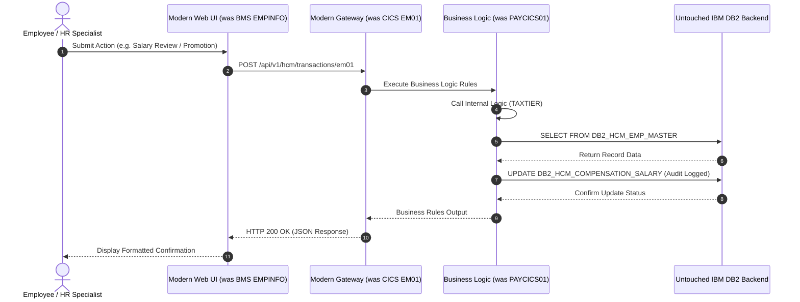

# CLAUDE.md — Workspace Construction & Architecture Contract

> **Target Engagement:** Client Pilot Engagement — Like-for-Like IBM HCM Modernization Replica  
> **Backend Architecture:** IBM DB2 Engine (LUW / z/OS Mainframe) — **UNTOUCHED & ZERO DDL MUTATION**  
> **Orchestrator & System of Record:** Evolve AI Delivery Studio  
> **Autonomous Code Builder:** Claude Code  

---

## 1. The Immutable Core Constraint: Untouched DB2 Backend

You are building a modernized like-for-like replica of the legacy IBM HCM application.
**CRITICAL RULE:** The existing IBM DB2 backend database schema MUST NOT be modified:
1. **ZERO DDL MUTATION**: Never generate or execute `ALTER TABLE`, `DROP TABLE`, or `ADD COLUMN` queries. Never configure ORMs with `ddl-auto=update` or auto-migrations.
2. **ZERO ASSUMPTIONS ON SEQUENCES**: Primary keys that use DB2 sequences must strictly use `SELECT NEXT VALUE FOR <SEQUENCE_NAME> FROM SYSIBM.SYSDUMMY1` (or DB2 native identity insertion).
3. **STORED PROCEDURE PRESERVATION**: High-impact payroll calculations and compensation adjustments are executed directly via existing DB2 SQL PL stored procedures to guarantee 100% calculation parity with legacy systems.
4. **TRANSACTION ISOLATION**: Maintain DB2 Cursor Stability (`CS`) transaction semantics. Never hold long-lived transactions across HTTP requests.

---

## 2. Introspected DB2 Schema & Stored Procedure Contracts

### Stored Procedures & Routines
- `SP_CALCULATE_PAYROLL_ACCRUAL(IN P_EMP_ID INTEGER, IN P_PAY_PERIOD_END VARCHAR(10), OUT P_GROSS_AMT DECIMAL(15,2), OUT P_NET_AMT DECIMAL(15,2), OUT P_STATUS_CD VARCHAR(20))` [PROCEDURE]
- `SP_PROCESS_PROMOTION_TIER(IN P_EMP_ID INTEGER, IN P_NEW_JOB_CODE VARCHAR(20), IN P_NEW_SALARY DECIMAL(15,2), IN P_APPROVER_USER_ID VARCHAR(50), OUT P_RESULT_MSG VARCHAR(100))` [PROCEDURE]

### Sequences
- `SEQ_HCM_EMP_ID` (Schema: `DB2ADMIN`, Type: `INTEGER`)
- `SEQ_HCM_SALARY_ID` (Schema: `DB2ADMIN`, Type: `INTEGER`)
- `SEQ_HCM_PAYROLL_RUN_ID` (Schema: `DB2ADMIN`, Type: `INTEGER`)
- `SEQ_HCM_ENROLLMENT_ID` (Schema: `DB2ADMIN`, Type: `INTEGER`)

### Tables & Column Definitions
### Table: `DB2_HCM_EMP_MASTER`
Schema: `DB2ADMIN`
Columns:
  - `EMP_ID` (integer, PRIMARY KEY)
  - `FIRST_NAME` (string, NOT NULL)
  - `LAST_NAME` (string, NOT NULL)
  - `WORK_EMAIL` (string, NOT NULL)
  - `DEPT_ID` (string, NOT NULL)
  - `JOB_CODE` (string, NOT NULL)
  - `HIRE_DT` (timestamp, NOT NULL)
  - `TERMINATION_DT` (timestamp)
  - `EMP_STATUS` (string, NOT NULL)
  - `ROW_CHANGE_TS` (timestamp, NOT NULL)

### Table: `DB2_HCM_COMPENSATION_SALARY`
Schema: `DB2ADMIN`
Columns:
  - `SALARY_REC_ID` (integer, PRIMARY KEY)
  - `EMP_ID` (integer, NOT NULL)
  - `BASE_ANNUAL_AMT` (numeric, NOT NULL)
  - `CURRENCY_CD` (string, NOT NULL)
  - `PAY_FREQUENCY` (string, NOT NULL)
  - `EFFECTIVE_START_DT` (timestamp, NOT NULL)
  - `EFFECTIVE_END_DT` (timestamp)
  - `APPROVED_BY_USER_ID` (string)
  - `ROW_CHANGE_TS` (timestamp)

### Table: `DB2_HCM_PAYROLL_RUN_AUDIT`
Schema: `DB2ADMIN`
Columns:
  - `RUN_ID` (integer, PRIMARY KEY)
  - `PAY_PERIOD_END_DT` (timestamp, NOT NULL)
  - `EMP_ID` (integer, NOT NULL)
  - `GROSS_PAY_AMT` (numeric, NOT NULL)
  - `NET_PAY_AMT` (numeric, NOT NULL)
  - `TAX_DEDUCTIONS_AMT` (numeric, NOT NULL)
  - `BENEFIT_DEDUCTIONS_AMT` (numeric)
  - `CALC_STATUS` (string, NOT NULL)
  - `RUN_TIMESTAMP` (timestamp, NOT NULL)

### Table: `DB2_HCM_BENEFITS_ENROLLMENT`
Schema: `DB2ADMIN`
Columns:
  - `ENROLLMENT_ID` (integer, PRIMARY KEY)
  - `EMP_ID` (integer, NOT NULL)
  - `BENEFIT_PLAN_CD` (string, NOT NULL)
  - `COVERAGE_TIER` (string, NOT NULL)
  - `EMPLOYEE_CONTRIB_PCT` (numeric)
  - `EMPLOYER_MATCH_AMT` (numeric)
  - `STATUS_CD` (string, NOT NULL)
  - `ENROLLMENT_DT` (timestamp)

---

## 3. Extracted IBM Mainframe Workflows (As-Is Source Contracts)

### A. Batch Payroll Workflow DAG (from JCL & DB2 Stored Procedures)
```mermaid
flowchart TD
    classDef stepNode fill:#1e293b,stroke:#3b82f6,stroke-width:2px,color:#f8fafc;
    classDef db2Node fill:#1e1e38,stroke:#10b981,stroke-width:2px,color:#6ee7b7;
    subgraph HCM_PAYROLL_RUN["IBM z/OS Mainframe Batch Job Stream: HCM_PAYROLL_RUN"]
        STEP01["<b>Step 1: STEP01</b><br/>PGM: <code>PAYEXTR</code><br/><small>Extract timecards & hours from DB2</small>"]:::stepNode
        STEP02["<b>Step 2: STEP02</b><br/>PGM: <code>TAXCALC</code><br/><small>Gross-to-net tax withholding computation</small>"]:::stepNode
        STEP03["<b>Step 3: STEP03</b><br/>PGM: <code>IKJEFT01</code><br/><small>Execute DB2 stored procedure accruals</small>"]:::stepNode
        STEP03_SP["DB2 SP: <code>SP_CALCULATE_PAYROLL_ACCRUAL</code>"]:::db2Node
        STEP03 -.->|Invokes SQL PL| STEP03_SP
        STEP04["<b>Step 4: STEP04</b><br/>PGM: <code>ACHGEN01</code><br/><small>Generate NACHA direct deposit flat files</small>"]:::stepNode
        STEP05["<b>Step 5: STEP05</b><br/>PGM: <code>GLPOST01</code><br/><small>Post journal entries to General Ledger</small>"]:::stepNode
        STEP01 |Passes OUT| STEP02
        STEP02 --> STEP03
        STEP03 --> STEP04
        STEP04 |Passes OUT| STEP05
    end
```

### B. Online Transaction Sequence (from CICS EM01 & BMS Screen Maps)


---

## 4. Target Modern Architecture Pattern

* **Presentation Layer**: React 19 / TypeScript with enterprise design system (Accessible, WCAG AA, Mobile-responsive ESS & MSS).
* **API & BFF Layer**: Clean REST / OpenAPI 3.0 specification with strict schema validation.
* **Hexagonal Persistence Adapter**:
  - All DB2 operations isolated behind strict domain repository interfaces.
  - Parameterized SQL queries only — zero raw SQL string concatenation.
  - Native DB2 JDBC / Wire driver connection pooling (`HikariCP` / `ibm_db`).
* **Human-in-the-Loop (HITL) Exception Gates**:
  - Salary updates exceeding threshold (`> $150,000` or `> 15%` adjustment) require two-factor cryptographic supervisor approval before committing to DB2.
  - Terminations and severance calculations require HR Director approval gate.

---

## 5. Verification & Quality Commands

When building or updating code in this workspace, verify your implementation with:
```bash
# Run local test suite against DB2 sandbox
npm test

# Verify TypeScript type safety
npx tsc --noEmit

# Start local IBM DB2 container sandbox (Offline Verification)
docker-compose -f docker-compose.db2-test.yml up -d
```

---

## 6. Evolve AI Pre-Push & Pre-Flight Compliance
Before committing code, verify:
- No hardcoded secrets or database passwords in source code.
- No dynamic SQL concatenation without bind variables.
- All database field names match DB2 catalog definitions exactly in UPPERCASE or mapped aliases.
